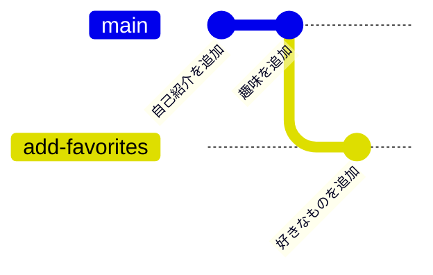

# 6日目：ブランチ

[← 5日目](day05-undo.md) ｜ [README（全体の地図）](../README.md) ｜ [7日目 →](day07-merge-conflict.md)

## この日のゴール

- ブランチ（branch）と HEAD（ヘッド）を、たとえを使って説明できる
- `git switch -c` でブランチを作って切り替えられる
- ブランチでの作業を fast-forward マージで `main` に取り込める
- 使い終わったブランチを `git branch -d` で削除できる

## 所要時間の目安

合計 **45〜60分**

| セクション | 目安 |
|---|---|
| 1. ブランチとは | 10分 |
| 2. ブランチを作って切り替える | 10分 |
| 3. ブランチで作業してコミットする | 10分 |
| 4. main に取り込む：fast-forward マージ | 5〜10分 |
| 5. 使い終わったブランチを削除する | 5分 |
| 6. VS Code でのブランチ操作 | 5〜15分 |

## 前提

- 3〜5日目を終えていること（`~/git-practice/my-profile` に、いくつかのコミットがある）
- `my-profile` に **コミットしていない変更が残っていない** こと（`git status` で `nothing to commit, working tree clean` と出る状態）。残っている場合は、コミットするか、5日目の方法で取り消してから始めてください。
- 演習：[exercises/day06-branch/README.md](../exercises/day06-branch/README.md)

---

## 1. ブランチとは

ブランチ（branch：枝）は、**「本流の作業に影響を与えずに、別の作業を進めるための並行世界」** です。

たとえば、自己紹介（`profile.md`）がひとまず完成している状態で、「好きなものページ」を新しく作りたいとします。作っている途中のページを本流（`main`）にいきなり混ぜると、未完成の状態が本流に残ってしまいます。そこで、

1. 本流から枝分かれした **並行世界（ブランチ）** を作る
2. 並行世界で好きなだけ作業・コミットする
3. 完成したら本流に取り込む（**マージ**（merge））
4. 並行世界は用済みなので削除する

という流れで進めます。これがブランチを使った作業の基本です。



（図は、ブランチでコミットしたところまでです。`main` に取り込んだ後の形は「4. main に取り込む」で見ます。）

もう1つのたとえとして、**ブランチは「コミットに貼った付箋」** と考えることもできます。`main` という名前の付箋が、いちばん新しいコミットに貼ってあるイメージです。新しいブランチを作るのは、同じコミットに **新しい付箋をもう1枚貼る** だけなので、一瞬で終わり、容量もほとんど使いません。コミットすると、今使っている付箋が新しいコミットへ貼り替えられます。

> [!NOTE]
> 実は、これまで使ってきた `main` もブランチの1つです。`git init` したときに自動で作られた、いちばん最初のブランチです（1日目に `init.defaultBranch main` を設定したので、名前が `main` になっています）。

---

## 2. ブランチを作って切り替える

### ブランチの一覧を見る

**Git Bash で**

1. VS Code のターミナル（Git Bash）で `my-profile` に移動します。

   ```bash
   cd ~/git-practice/my-profile
   ```

2. ブランチの一覧を表示します。

   ```bash
   git branch
   ```

   ```text
   * main
   ```

   `*` が付いているのが **今いるブランチ** です。まだ `main` しかありません。

> [!TIP]
> Git Bash のプロンプト（入力待ちの行）にも、`~/git-practice/my-profile (main)` のように、かっこの中に今いるブランチ名が表示されています。

**VS Code で**

- 画面左下の **ステータスバー** に、今いるブランチ名（`main`）が表示されています。

### 作って切り替える

`add-favorites`（好きなものを追加する、という意味）という名前のブランチを作り、そこへ切り替えます。

**Git Bash で**

1. ブランチを作って、同時に切り替えます。

   ```bash
   git switch -c add-favorites
   ```

   ```text
   Switched to a new branch 'add-favorites'
   ```

   `-c` は「create（作る）」の意味です。`-c` を付けないと「すでにあるブランチに切り替える」だけになります。

2. 一覧で確かめます。

   ```bash
   git branch
   ```

   ```text
   * add-favorites
     main
   ```

   `*` が `add-favorites` に移りました。プロンプトも `(add-favorites)` に変わっています。

> [!NOTE]
> ブランチ名には英小文字・数字・ハイフン（`-`）を使うのが無難です。スペースは使えません。日本語も使えますが、入力や表示のトラブルを避けるため、この勉強会では英語にします。

### HEAD とは

**HEAD（ヘッド）** は、**「今どのブランチにいるか」を指す目印** です。付箋のたとえでいうと、「今、自分が手に持っている付箋はこれ」という目印です。

- `git switch` でブランチを切り替える ＝ HEAD が別のブランチを指すようにする
- コミットする ＝ HEAD が指しているブランチ（付箋）が、新しいコミットに貼り替えられる

HEAD の正体は `.git` フォルダの中にある小さなファイルです。中身をのぞいてみましょう（見るだけで、編集はしないでください）。

```bash
cat .git/HEAD
```

```text
ref: refs/heads/add-favorites
```

「HEAD は `add-favorites` ブランチを指している」という意味です。

履歴をグラフで見ると、HEAD とブランチの関係がわかります。

```bash
git log --oneline --graph --all
```

```text
* 3c4d5e6 (HEAD -> add-favorites, main) 趣味のページを追加
* 2b3c4d5 自己紹介に目標を追加
* 1a2b3c4 自己紹介を追加
```

（ハッシュ値やメッセージは人によって違います。）

`(HEAD -> add-favorites, main)` は「最新のコミットに `add-favorites` と `main` の2枚の付箋が貼ってあり、HEAD は `add-favorites` を指している」という意味です。ブランチを作っただけなので、2つのブランチは同じコミットを指しています。

> [!TIP]
> ブランチや HEAD が Git の内部でどう記録されているかは、[Appendix：Git の内部構造](../appendix/git-internals.md) と [Appendix：ブランチとマージ](../appendix/branches-and-merge.md) で詳しく説明しています。

---

## 3. ブランチで作業してコミットする

`add-favorites` ブランチの上で、「好きなもの」ページを追加します。

1. 今いるブランチが `add-favorites` であることを確かめます。

   ```bash
   git branch
   ```

   ```text
   * add-favorites
     main
   ```

2. 素材 `favorites.md` を、教材のフォルダから `my-profile` にコピーします。

   ```bash
   cp ~/git-practice/gitlearn/exercises/day06-branch/favorites.md ~/git-practice/my-profile/
   ```

3. VS Code のエクスプローラーで `favorites.md` を開き、「（ここを自分の内容に書き換える）」と書かれた部分を、自分の好きなものに書き換えて保存します（`Ctrl+S`）。

   > [!CAUTION]
   > 本名のフルネーム、住所、電話番号、学籍番号などの個人情報は書かないでください。8日目に GitHub に公開することがあります。

4. 状態を確認します。

   ```bash
   git status
   ```

   ```text
   On branch add-favorites
   Untracked files:
     (use "git add <file>..." to include in what will be committed)
   	favorites.md

   nothing added to commit but untracked files present (use "git add" to track)
   ```

   1行目が `On branch add-favorites` になっていることに注目してください。

5. ステージします。

   ```bash
   git add favorites.md
   ```

6. コミットします。

   ```bash
   git commit -m "好きなものページを追加"
   ```

   ```text
   [add-favorites 4d5e6f7] 好きなものページを追加
    1 file changed, 16 insertions(+)
    create mode 100644 favorites.md
   ```

   `[add-favorites ...]` と、コミットしたブランチ名が表示されます（ハッシュ値と行数は人によって違います）。

7. 履歴をグラフで見ます。

   ```bash
   git log --oneline --graph --all
   ```

   ```text
   * 4d5e6f7 (HEAD -> add-favorites) 好きなものページを追加
   * 3c4d5e6 (main) 趣味のページを追加
   * 2b3c4d5 自己紹介に目標を追加
   * 1a2b3c4 自己紹介を追加
   ```

   `add-favorites` の付箋だけが新しいコミットへ進み、`main` は1つ前に残っています。

### main に戻ると、ファイルが「消えて」見える

ここがブランチのいちばん面白いところです。

1. `main` に切り替えます。

   ```bash
   git switch main
   ```

   ```text
   Switched to branch 'main'
   ```

2. ファイルの一覧を見ます。

   ```bash
   ls
   ```

   ```text
   hobbies.md  profile.md
   ```

   （ほかのファイルがあっても構いません。）`favorites.md` がありません！ VS Code のエクスプローラーからも消えています。

3. もう一度 `add-favorites` に切り替えます。

   ```bash
   git switch add-favorites
   ```

4. もう一度 `ls` を実行します。

   ```bash
   ls
   ```

   ```text
   favorites.md  hobbies.md  profile.md
   ```

   `favorites.md` が戻ってきました。

ファイルは消えたわけではありません。`git switch` は、**ワーキングツリー（working tree：実際に編集しているファイル）を、切り替え先のブランチが指すコミットの状態に入れ替える** コマンドです。`main` の世界にはまだ `favorites.md` が存在しないので、見えなくなったのです。

> [!WARNING]
> コミットしていない変更があると、ブランチを切り替えられないことがあります（`error: Your local changes to the following files would be overwritten by checkout` など）。切り替える前に、**コミットしてから** 切り替える習慣をつけましょう。対処法は [レシピ branch-03](../recipes/branch.md#branch-03) を見てください。

---

## 4. main に取り込む：fast-forward マージ

「好きなもの」ページが完成したので、`main` に取り込みます。**マージは「取り込む側のブランチ」に移動してから実行する** のがポイントです。

1. 取り込む側の `main` に切り替えます。

   ```bash
   git switch main
   ```

2. `add-favorites` を `main` にマージします。

   ```bash
   git merge add-favorites
   ```

   ```text
   Updating 3c4d5e6..4d5e6f7
   Fast-forward
    favorites.md | 16 ++++++++++++++++
    1 file changed, 16 insertions(+)
    create mode 100644 favorites.md
   ```

3. ファイルを確認します。

   ```bash
   ls
   ```

   ```text
   favorites.md  hobbies.md  profile.md
   ```

   `main` にも `favorites.md` が入りました。

4. 履歴をグラフで見ます。

   ```bash
   git log --oneline --graph --all
   ```

   ```text
   * 4d5e6f7 (HEAD -> main, add-favorites) 好きなものページを追加
   * 3c4d5e6 趣味のページを追加
   * 2b3c4d5 自己紹介に目標を追加
   * 1a2b3c4 自己紹介を追加
   ```

### fast-forward とは

出力にあった **Fast-forward（早送り）** は、いちばん単純なマージです。

- `add-favorites` を作ってから、`main` には何もコミットしていませんでした。
- つまり `main` から見ると、`add-favorites` は「自分の続きにコミットを足しただけ」の状態です。
- そこで Git は、新しいコミットを作らずに、**`main` の付箋を `add-favorites` と同じコミットまで早送りで移動** させるだけで済ませます。

```text
マージ前                         マージ後（fast-forward）
A---B---C   (main)               A---B---C---D   (main, add-favorites)
         \
          D (add-favorites)
```

> [!NOTE]
> `main` 側にも新しいコミットがある場合は、早送りができないので、Git は2つの流れを合流させる「マージコミット」を作ります。これは7日目に学びます。

---

## 5. 使い終わったブランチを削除する

`add-favorites` の作業は `main` に取り込まれたので、付箋（ブランチ）はもう不要です。残しておくと一覧がごちゃごちゃするので削除します。

1. `main` にいることを確かめます（今いるブランチは削除できません）。

   ```bash
   git branch
   ```

   ```text
     add-favorites
   * main
   ```

2. ブランチを削除します。

   ```bash
   git branch -d add-favorites
   ```

   ```text
   Deleted branch add-favorites (was 4d5e6f7).
   ```

3. 一覧と履歴を確かめます。

   ```bash
   git branch
   ```

   ```text
   * main
   ```

   ```bash
   git log --oneline --graph --all
   ```

   ```text
   * 4d5e6f7 (HEAD -> main) 好きなものページを追加
   * 3c4d5e6 趣味のページを追加
   ...
   ```

   ブランチを削除しても、**コミット（「好きなものページを追加」）は消えません**。消えたのは付箋だけです。

> [!WARNING]
> `main` に取り込んでいないブランチを `-d` で消そうとすると、次のように断られます。
>
> ```text
> error: the branch 'add-favorites' is not fully merged
> ```
>
> これは「まだ取り込んでいない作業が消えてしまいますよ」という安全装置です。本当に要らないときだけ `-D`（大文字）で強制削除できますが、使う前に [レシピ branch-04](../recipes/branch.md#branch-04) を確認してください。

---

## 6. VS Code でのブランチ操作

ここまでの操作は、VS Code の画面からもできます。もう一度、別のブランチで練習してみましょう（ブランチ名は自由です。ここでは `add-motto` を例にします）。

### ブランチを作って切り替える

1. 画面左下のステータスバーにあるブランチ名（`main`）をクリックします。
2. 画面上部に一覧が出るので、「**＋ 新しいブランチの作成...**（Create new branch...）」を選びます（執筆時点の表示です）。
3. ブランチ名 `add-motto` を入力して `Enter` を押します。
4. ステータスバーの表示が `add-motto` に変わったことを確かめます。

> [!TIP]
> コマンドパレット（`Ctrl+Shift+P`）で「**Git: ブランチの作成...**（Git: Create Branch...）」を実行しても同じです。

### ブランチで作業してコミットする

1. `profile.md` に「座右の銘」などを1行追加して保存します。
2. 左側の **ソース管理ビュー**（`Ctrl+Shift+G`）を開きます。
3. 「変更（Changes）」の `profile.md` にマウスを乗せ、「**+**」（変更をステージ／Stage Changes）をクリックします。
4. メッセージ欄に「座右の銘を追加」と入力し、「**✓ コミット**（Commit）」をクリックします。

### ブランチを切り替える

1. ステータスバーのブランチ名（`add-motto`）をクリックします。
2. 一覧から `main` を選びます。
3. `profile.md` から追加した行が消えたことを確かめます。

> [!TIP]
> コマンドパレットの「**Git: チェックアウト先...**（Git: Checkout to...）」でも切り替えられます。名前に「チェックアウト」とありますが、ブランチを切り替える操作です。

### main に取り込む

1. `main` にいることを確かめます（ステータスバーが `main`）。
2. コマンドパレット（`Ctrl+Shift+P`）を開き、「**Git: マージ...**（Git: Merge...）」を実行します。
3. 取り込むブランチとして `add-motto` を選びます。
4. `profile.md` に追加した行が現れたことを確かめます。

### ブランチを削除する

1. コマンドパレットで「**Git: ブランチの削除...**（Git: Delete Branch...）」を実行します。
2. 一覧から `add-motto` を選びます。

最後に、Git Bash で結果を確かめましょう。

```bash
git log --oneline --graph --all
```

```text
* 5e6f7a8 (HEAD -> main) 座右の銘を追加
* 4d5e6f7 好きなものページを追加
...
```

---

## 確認チェックリスト

- [ ] ブランチと HEAD を、付箋のたとえで説明できる
- [ ] `git switch -c add-favorites` でブランチを作り、`git branch` で `*` が移ったことを確かめた
- [ ] `add-favorites` で `favorites.md` をコミットし、`main` に切り替えるとファイルが見えなくなることを確かめた
- [ ] `git switch main` → `git merge add-favorites` で `Fast-forward` と表示された
- [ ] `git branch -d add-favorites` で削除し、`git branch` に `main` だけが残っている
- [ ] `git log --oneline --graph --all` で「好きなものページを追加」のコミットが `main` にあることを確かめた
- [ ] VS Code のステータスバーからブランチを作成・切り替えできた
- [ ] 演習 [exercises/day06-branch/README.md](../exercises/day06-branch/README.md) の完了条件を満たした

## よくあるつまずき

**症状：`git switch` で `error: Your local changes to the following files would be overwritten by checkout` と出て切り替えられない**
- 原因：コミットしていない変更があり、切り替えると上書きされてしまうため、Git が止めています。
- 対処：変更をコミットしてから切り替えます。変更が不要なら `git restore profile.md` のように、ファイル名を指定して取り消します（5日目。`profile.md` の部分は自分の変更したファイル名に置き換えます）。→ [レシピ branch-03](../recipes/branch.md#branch-03)

**症状：`git switch -c` で `fatal: a branch named 'add-favorites' already exists` と出る**
- 原因：同じ名前のブランチがすでにあります。
- 対処：`git switch add-favorites`（`-c` なし）で切り替えます。→ [レシピ branch-02](../recipes/branch.md#branch-02)

**症状：`main` のまま `favorites.md` をコミットしてしまった**
- 原因：ブランチを作る前、または切り替える前に作業してしまいました。
- 対処：まだ push していなければ、作業を新しいブランチに移せます。→ [レシピ branch-07](../recipes/branch.md#branch-07)。練習としては、そのまま進めても大きな問題はありません。

**症状：`git merge add-favorites` で「Already up to date.」と出た**
- 原因：`add-favorites` に `main` にない新しいコミットがない（コミットし忘れ、または `add-favorites` にいるまま実行した）。
- 対処：`git branch` で今いるブランチを確認し、`git log --oneline --graph --all` で `add-favorites` にコミットがあるか確かめます。→ [レシピ branch-05](../recipes/branch.md#branch-05)

**症状：`git branch -d` で `error: cannot delete branch 'add-favorites' used by worktree at ...` と出る**
- 原因：今いるブランチは削除できません。
- 対処：`git switch main` で別のブランチに移ってから削除します。→ [レシピ branch-04](../recipes/branch.md#branch-04)

**症状：`favorites.md` が消えた！**
- 原因：`main`（まだマージしていない）に切り替えたため、見えなくなっています。
- 対処：`git switch add-favorites` で戻れば見えます。`git branch` で今いる場所を確かめましょう。→ [レシピ branch-01](../recipes/branch.md#branch-01)

## もっと知りたい人へ

- [Appendix：ブランチとマージ](../appendix/branches-and-merge.md)：ブランチ＝コミットを指すポインタ、HEAD、fast-forward と 3-way マージ
- [Appendix：Git の内部構造](../appendix/git-internals.md)：`.git` の中でブランチと HEAD がどう記録されているか
- レシピ
  - [branch-01 ブランチの一覧と、今いるブランチを確認したい](../recipes/branch.md#branch-01)
  - [branch-02 新しいブランチを作って切り替えたい](../recipes/branch.md#branch-02)
  - [branch-03 未コミットの変更があってブランチを切り替えられない](../recipes/branch.md#branch-03)
  - [branch-04 ブランチを削除したい（手元・GitHub・追跡ブランチ）](../recipes/branch.md#branch-04)
  - [branch-05 ブランチを取り込みたい（マージ）](../recipes/branch.md#branch-05)
  - [branch-07 間違えて main で作業してしまった変更を、新しいブランチに移したい](../recipes/branch.md#branch-07)

<!-- 出典（執筆時点で確認）：VS Code のコマンド名の日本語表示は Microsoft の日本語言語パックの翻訳 https://github.com/microsoft/vscode-loc （vscode.git の翻訳ファイル）を参照 -->

---
[← 5日目](day05-undo.md) ｜ [README](../README.md) ｜ [7日目 →](day07-merge-conflict.md)
