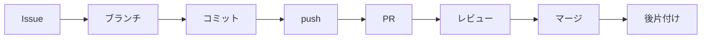

# 10日目：はじめてのプルリクエスト

[← 9日目](day09-team-kickoff.md) ｜ [README（全体の地図）](../README.md) ｜ [11日目 →](day11-code-review.md)

## この日のゴール

- Issue → ブランチ → コミット → push → プルリクエスト（Pull Request、略して PR）→ 承認（Approve）→ マージ → 後片付け の流れを1周できる
- PR の本文に `Closes #番号` と書いて、PR と Issue を紐づけられる
- レビューの組の相手の PR を確認し、承認（Approve）できる

## 所要時間の目安

合計 **60分**（各自のペースで進めます。レビューの相手を待つ時間は含みません）

| セクション                                  | 目安 |
| ------------------------------------------- | ---- |
| 1. プルリクエストとは                       | 5分  |
| 2. チーム開発の1周の流れ                    | 5分  |
| 3. ブランチを作ってメンバー紹介ページを書く | 15分 |
| 4. ブランチを push する                     | 5分  |
| 5. プルリクエストを作る                     | 10分 |
| 6. かんたんなレビューとマージ               | 15分 |
| 7. 手元の main を最新にする                 | 5分  |

> [!TIP]
> レビューの相手の都合で待ち時間が出ます。「PR を出す」までと「レビュー・マージ・後片付け」を、別々の時間に行っても構いません。

## 前提

- 9日目を終えていること
  - `~/git-practice/gitlearn-team-<チーム記号>` にチームリポジトリをクローンしてある
  - 自分用の「メンバー紹介ページを追加」Issue があり、その **番号** を控えている
  - 自分の役割記号と、**レビューの組**（自分の PR を誰がレビューするか、自分が誰の PR をレビューするか）を把握している
- 今日の進行役は **B** です。
- 演習：[exercises/day10-first-pr/README.md](../exercises/day10-first-pr/README.md)

---

## 1. プルリクエストとは

**プルリクエスト（PR）** は、「**このブランチの変更を `main` に取り込んでください**」と、チームにお願いする GitHub の機能です。

6〜7日目は、自分で `git merge` して `main` に取り込みました。ひとりならそれで十分ですが、チームでは「誰かが勝手に `main` を書き換える」と困ります。そこで、

1. 自分のブランチを GitHub に push する
2. PR を作って「取り込んでほしい」とお願いする
3. ほかのメンバーが変更を確認（**レビュー**）し、問題なければ **承認（Approve）** する
4. GitHub 上でマージする

という手順をふみます。PR は、変更内容・説明・レビューのやりとりが1つのページにまとまるので、「いつ、誰が、なぜ、何を変えたか」が記録に残ります。

> [!NOTE]
> 「プル（pull）リクエスト」という名前は、「私のブランチを、あなたたちの `main` に pull（取り込み）してください」というお願いから来ています。

PR の画面でよく使う言葉です。

| 言葉              | 意味                                                         |
| ----------------- | ------------------------------------------------------------ |
| **base**          | 取り込む先のブランチ（この勉強会では `main`）                |
| **compare**       | 取り込んでほしい、自分のブランチ                             |
| **Conversation**  | PR の説明とコメントのやりとりが並ぶタブ                      |
| **Commits**       | PR に含まれるコミットの一覧                                  |
| **Files changed** | PR で変わったファイルと差分（4日目の `git diff` と同じもの） |

---

## 2. チーム開発の1周の流れ

今日は、次の流れを **全員が1周** します。11日目以降も、すべての作業がこの流れです。



| 段階     | 誰が       | 何をする                                                              | どこで        |
| -------- | ---------- | --------------------------------------------------------------------- | ------------- |
| Issue    | 作成者     | やることを書く（9日目に作成済み）                                     | GitHub        |
| ブランチ | 作成者     | `main` を最新にしてからブランチを作る                                 | 手元          |
| コミット | 作成者     | ファイルを編集してコミット                                            | 手元          |
| push     | 作成者     | ブランチを GitHub に送る                                              | 手元 → GitHub |
| PR       | 作成者     | PR を作り、Issue と紐づけ、レビュアーを指定                           | GitHub        |
| レビュー | レビュアー | 変更を確認して承認（Approve）                                         | GitHub        |
| マージ   | **作成者** | 承認（Approve）されたら「Create a merge commit」でマージ              | GitHub        |
| 後片付け | 作成者     | GitHub のブランチを削除、手元の `main` を最新に、手元のブランチを削除 | GitHub・手元  |

> [!NOTE]
> 今日は全員が **別々のファイル**（自分のメンバー紹介ページ）を追加するだけなので、**コンフリクトは起きません**。PR の流れに集中してください。また、メンバー一覧 `exercises/team-project/members/README.md` は **今日は編集しません**（13日目にまとめて作ります）。

---

## 3. ブランチを作ってメンバー紹介ページを書く

ここからは、チームリポジトリのフォルダで作業します。VS Code でチームリポジトリのフォルダ（`gitlearn-team-<チーム記号>`）を開いていることを、ウィンドウのタイトルで確かめてください。

以下のコードブロックの `<...>` の部分は、かっこごと置き換えてから実行します。

1. チームリポジトリのフォルダに移動します。

   ```bash
   cd ~/git-practice/gitlearn-team-<チーム記号>
   ```

2. `main` に切り替えます（チームのルール5）。

   ```bash
   git switch main
   ```

3. `main` を最新にします。

   ```bash
   git pull
   ```

   ```text
   Already up to date.
   ```

   （ほかのメンバーがすでにマージしていれば、`Fast-forward` と表示されて取り込まれます。）

4. 作業用のブランチを作って切り替えます（チームのルール2）。

   ```bash
   git switch -c <GitHubユーザー名>/add-member-page
   ```

   ```text
   Switched to a new branch 'hydr4/add-member-page'
   ```

   （出力例は、GitHubユーザー名が `hydr4` の場合です。）

5. ひな形 `_template.md` を、自分のユーザー名のファイルとしてコピーします。

   ```bash
   cp exercises/team-project/members/_template.md exercises/team-project/members/<GitHubユーザー名>.md
   ```

6. VS Code のエクスプローラーで `exercises/team-project/members/<GitHubユーザー名>.md` を開き、ひな形の書き換え箇所（ニックネーム、担当役割、好きなこと、ひとこと）を自分の内容にして保存します（`Ctrl+S`）。

   > [!CAUTION]
   > 本名のフルネーム、電話番号、住所、学籍番号、顔写真は書かないでください（チームのルール6）。

7. `Ctrl+Shift+V` でプレビューを開き、表示が崩れていないか確かめます。
8. 状態を確認します。

   ```bash
   git status
   ```

   ```text
   On branch hydr4/add-member-page
   Untracked files:
     (use "git add <file>..." to include in what will be committed)
   	exercises/team-project/members/hydr4.md

   nothing added to commit but untracked files present (use "git add" to track)
   ```

   **新しく増えたのが自分のファイル1つだけ** であることを確かめます。`_template.md` や `members/README.md` が `modified` になっていたら、`git restore exercises/team-project/members/README.md` のように、そのファイルを指定して元に戻してください（`_template.md` なら `git restore exercises/team-project/members/_template.md`）。

9. ステージします。

   ```bash
   git add exercises/team-project/members/<GitHubユーザー名>.md
   ```

10. コミットします。

    ```bash
    git commit -m "メンバー紹介ページを追加"
    ```

**VS Code で** ブランチを作る場合は、ステータスバーのブランチ名（`main`）をクリック →「新しいブランチの作成...（Create new branch...）」→ `<GitHubユーザー名>/add-member-page` を入力します。ステージとコミットは、ソース管理ビューの「+」と「✓ コミット」で行えます（6日目と同じです）。

---

## 4. ブランチを push する

作ったブランチは、まだ手元にしかありません。GitHub に送ります。

**Git Bash で**

1. ブランチを初めて push します。8日目と同じく、最初の1回は `-u` を付けます。

   ```bash
   git push -u origin <GitHubユーザー名>/add-member-page
   ```

   ```text
   ...
   remote:
   remote: Create a pull request for 'hydr4/add-member-page' on GitHub by visiting:
   remote:      https://github.com/<運営者のアカウント>/gitlearn-team-a/pull/new/hydr4/add-member-page
   remote:
   To https://github.com/<運営者のアカウント>/gitlearn-team-a.git
    * [new branch]      hydr4/add-member-page -> hydr4/add-member-page
   branch 'hydr4/add-member-page' set up to track 'origin/hydr4/add-member-page'.
   ```

   GitHub が「PR を作るならこの URL へ」と教えてくれています（`Ctrl` を押しながら URL をクリックすると開けます）。

**VS Code で**

1. ソース管理ビュー（`Ctrl+Shift+G`）を開きます。
2. 「**Branch の発行**（Publish Branch）」ボタンをクリックします（執筆時点の表示です）。
3. リモートを選ぶよう聞かれたら `origin` を選びます。

「Branch の発行」は、今いるブランチを `git push -u origin` に続けてブランチ名を付けて push するのと同じ動きです（上の `git push -u origin <GitHubユーザー名>/add-member-page`）。

> [!WARNING]
> `git push` で `main` を送らないように注意してください（チームのルール1）。`git branch` で、自分が `<GitHubユーザー名>/add-member-page` にいることを確かめてから push しましょう。

---

## 5. プルリクエストを作る

1. ブラウザでチームリポジトリ（`https://github.com/<運営者のアカウント>/gitlearn-team-<チーム記号>`）を開きます。
2. ファイル一覧の上に、黄色い帯で「**`<GitHubユーザー名>/add-member-page` had recent pushes**」と、**Compare & pull request** ボタンが表示されています。**Compare & pull request** をクリックします。

   > [!TIP]
   > 帯が出ていない場合は、**Pull requests** タブ → **New pull request** をクリックし、**compare** に自分のブランチを選びます。

3. 画面上部の **base** と **compare** を確かめます。

   ```text
   base: main  ←  compare: <GitHubユーザー名>/add-member-page
   ```

   「自分のブランチを `main` に取り込む」という向きになっていれば正しいです。その横に **Able to merge.**（コンフリクトなしでマージできる）と表示されていることも確かめます。

4. **Add a title**（タイトル）を確認します。コミットメッセージ「メンバー紹介ページを追加」が自動で入っています。必要なら「メンバー紹介ページを追加（<GitHubユーザー名>）」のように直します。

出典：[Creating a pull request（GitHub Docs）](https://docs.github.com/en/pull-requests/collaborating-with-pull-requests/proposing-changes-to-your-work-with-pull-requests/creating-a-pull-request)（執筆時点で確認）

### PR テンプレートを埋める

本文（**Add a description**）には、リポジトリの `.github/pull_request_template.md` から **PR テンプレート** が自動で入っています。次のように埋めます。

1. **関連 Issue**：次の「Issue と紐づける」で書きます。
2. **変更内容**：「`exercises/team-project/members/<GitHubユーザー名>.md` を追加しました」のように、何をしたかを書きます。
3. **確認したこと**：チェックボックス `- [ ]` のうち、確認できたものの `[ ]` を `[x]` に書き換えます。
   - プレビューで表示を確認した
   - 個人情報が入っていない
   - `main` を最新にしてから作業した
4. **レビューしてほしい点**：「誤字がないか見てください」など、あれば書きます。

5. **Preview** タブで、表示を確かめます。

### Issue と紐づける

本文の「関連 Issue」の欄に、9日目に作った自分の Issue の番号を次のように書きます。`<Issue番号>` の部分は、かっこごと置き換えます。

```text
Closes #<Issue番号>
```

たとえば Issue が #3 なら `Closes #3` です。こう書いておくと、**この PR が `main` にマージされたときに、Issue #3 が自動で Close（完了）** されます。

> [!NOTE]
> `Closes` のほかに `Fixes`、`Resolves` なども使えます。自動で閉じるのは、PR の取り込み先が **既定のブランチ（`main`）** のときだけです。出典：[Linking a pull request to an issue（GitHub Docs）](https://docs.github.com/en/issues/tracking-your-work-with-issues/using-issues/linking-a-pull-request-to-an-issue)

### PR を作成する

1. **Create pull request** ボタンをクリックします。

   > [!NOTE]
   > ボタン横の ▼ から **Create draft pull request**（下書きの PR）も選べますが、今日は使いません。

2. PR のページが開き、タイトルの横に **#番号** が付きます。状態が緑色の **Open** になっていることを確かめます。

### レビュアーを指定する

レビューの組（9日目）に従って、自分の PR をレビューする人（「次の記号の人」）を指定します。

| PR を出す人 | 4人チームのレビュアー | 3人チームのレビュアー |
| ----------- | --------------------- | --------------------- |
| A           | B                     | B                     |
| B           | C                     | C                     |
| C           | D                     | A                     |
| D           | A                     | —                     |

1. PR のページ右側の **Reviewers** の歯車（またはその見出し）をクリックします。
2. レビュアーのユーザー名を入力し、候補から選びます。
3. 一覧の外をクリックして閉じます。**Reviewers** にその人が表示されれば完了です。相手に通知が届きます。
4. ついでに、**Assignees** に自分を、**Labels** に `documentation` を付けておきましょう（9日目と同じ操作です）。

出典：[Requesting a pull request review（GitHub Docs）](https://docs.github.com/en/pull-requests/collaborating-with-pull-requests/proposing-changes-to-your-work-with-pull-requests/requesting-a-pull-request-review)

> [!TIP]
> Conversation タブのコメント欄で「@hydr4 レビューをお願いします！」（`hydr4` の部分はレビュアーのユーザー名に置き換えます）と書いておくと、より確実に伝わります。

---

## 6. かんたんなレビューとマージ

ここからは **レビュアー** と **作成者** で役割が分かれます。自分の PR では「作成者」、自分がレビューを頼まれた PR では「レビュアー」として作業します。

> [!NOTE]
> 今日のレビューは「見て、問題なければ承認（Approve）する」だけのかんたんなものです。行コメントや修正提案などの本格的なレビューは11日目に学びます。

### Files changed を見て Approve する（レビュアーが行う）

1. チームリポジトリの **Pull requests** タブを開き、レビューを頼まれた PR をクリックします。
2. **Files changed** タブをクリックします。追加されたファイル（`exercises/team-project/members/` の下の、相手のユーザー名のファイル）の内容が緑色で表示されます。
3. 次の点を確かめます。
   - 変更されたファイルが **相手のメンバー紹介ページ1つだけ** か
   - 個人情報が入っていないか
   - 誤字や、表示の崩れがないか（ファイル右上の「…」→ **View file** で、表示された状態を確認できます）
4. 画面右上の **Review changes** ボタンをクリックします（新しい画面では **Submit review** ボタンの場合があります）。
5. コメント欄に、ひとこと感想を書きます（例：「好きなものの説明が楽しいです！ Approve します」）。
6. **Approve** を選びます。
7. **Submit review** をクリックします。
8. Conversation タブに「**approved these changes**」と表示されたことを確かめます。

出典：[Reviewing proposed changes in a pull request（GitHub Docs）](https://docs.github.com/en/pull-requests/collaborating-with-pull-requests/reviewing-changes-in-pull-requests/reviewing-proposed-changes-in-a-pull-request)（執筆時点で確認。Files changed の画面は改修が続いているため、ボタンの位置が変わっている場合があります）

> [!NOTE]
> 自分の PR を自分で承認（Approve）することはできません。必ず組の相手にお願いします。

### Merge pull request でマージする（作成者が行う）

チームのルール3に従い、承認（Approve）されたら **作成者が** マージします。

1. 自分の PR のページ（Conversation タブ）を開きます。
2. 下のほうに、レビュアーの承認（Approve）と、**This branch has no conflicts with the base branch**（コンフリクトなし）が表示されていることを確かめます。
3. **Merge pull request** ボタンをクリックします。

   > [!WARNING]
   > ボタンが **Squash and merge** や **Rebase and merge** になっている場合は、ボタン右の ▼ をクリックして **Create a merge commit** を選んでから押してください（チームのルール3）。

4. マージコミットのメッセージ欄が表示されます。そのままで構いません。
5. **Confirm merge** をクリックします。
6. PR の状態が紫色の **Merged** に変わったことを確かめます。

出典：[Merging a pull request（GitHub Docs）](https://docs.github.com/en/pull-requests/collaborating-with-pull-requests/incorporating-changes-from-a-pull-request/merging-a-pull-request)

### ブランチを削除する（作成者が行う）

1. マージ直後の画面に表示される「**Pull request successfully merged and closed**」の横の **Delete branch** ボタンをクリックします（執筆時点の表示です）。
2. GitHub 上の `<GitHubユーザー名>/add-member-page` ブランチが削除されます（チームのルール4）。

> [!NOTE]
> ブランチを削除しても、コミットはマージによって `main` に入っているので消えません。間違えて消した場合も、同じ場所に **Restore branch** ボタンが表示されるので元に戻せます。

---

## 7. 手元の main を最新にする

GitHub の `main` にはマージされましたが、**手元の `main` はまだ古いまま** です。後片付けをしましょう（チームのルール4）。

**Git Bash で**

1. `main` に切り替えます。

   ```bash
   git switch main
   ```

   エクスプローラーから、自分のメンバー紹介ページが消えたように見えます（手元の `main` にはまだ入っていないため。6日目と同じです）。

2. GitHub の最新を取り込みます。

   ```bash
   git pull
   ```

   ```text
   From https://github.com/<運営者のアカウント>/gitlearn-team-a
      1a2b3c4..5d6e7f8  main       -> origin/main
   Updating 1a2b3c4..5d6e7f8
   Fast-forward
    exercises/team-project/members/hydr4.md | 21 +++++++++++++++++++++
    1 file changed, 21 insertions(+)
    create mode 100644 exercises/team-project/members/hydr4.md
   ```

   自分のページ（と、先にマージしたメンバーのページ）が入ってきました。ハッシュ値や行数は人によって違います。

3. 手元の作業用ブランチを削除します。`<...>` の部分は、かっこごと置き換えてから実行します。

   ```bash
   git branch -d <GitHubユーザー名>/add-member-page
   ```

   ```text
   Deleted branch hydr4/add-member-page (was 4d5e6f7).
   ```

4. 履歴を確かめます。

   ```bash
   git log --oneline --graph --all
   ```

   `Merge pull request #番号 from ...` というマージコミットができ、`(HEAD -> main, origin/main)` になっていれば完了です。

> [!TIP]
> `git log --oneline --graph --all` に `origin/<GitHubユーザー名>/add-member-page` が残って見えることがあります。これは GitHub 上で削除したブランチの「控え」です。`git fetch --prune` を実行すると消えます。→ [レシピ branch-04](../recipes/branch.md#branch-04)

**VS Code で**

1. ステータスバーのブランチ名をクリックし、`main` を選びます。
2. ソース管理ビューの「…」→「プル（Pull）」、またはステータスバーの同期アイコンをクリックします。
3. コマンドパレットで「**Git: ブランチの削除...**（Git: Delete Branch...）」を実行し、`<GitHubユーザー名>/add-member-page` を選びます。

### Issue が自動で閉じたことを確かめる

1. ブラウザでチームリポジトリの **Issues** タブを開きます。
2. 自分の「メンバー紹介ページを追加」Issue が一覧から消えていることを確かめます（既定では Open の Issue だけが表示されます）。
3. 一覧の上の **Closed** をクリックすると、自分の Issue が表示されます。開くと「**closed this as completed in #PR番号**」のように、PR によって閉じられた記録が残っています。

おめでとうございます！ これでチーム開発の1周が完了しました。

> [!TIP]
> 進行役（B）は、全員の PR がマージされ、全員の Issue が Close になったことを確認して、チームに声をかけましょう。

---

## 確認チェックリスト

- [ ] `git switch main` → `git pull` で最新にしてから、`<GitHubユーザー名>/add-member-page` ブランチを作った
- [ ] `exercises/team-project/members/<GitHubユーザー名>.md` を作ってコミットし、`members/README.md` や `_template.md` は変更していない
- [ ] ブランチを push し、GitHub に `<GitHubユーザー名>/add-member-page` ブランチが表示された
- [ ] PR を作り、本文に `Closes #<Issue番号>` を書き、レビュアー（レビューの組の相手）を指定した
- [ ] 組の相手の PR を Files changed で確認し、承認（Approve）した
- [ ] 自分の PR が承認（Approve）されたあと、「Create a merge commit」でマージし、GitHub 上のブランチを削除した
- [ ] 手元で `git switch main` → `git pull` → `git branch -d <GitHubユーザー名>/add-member-page` を実行した
- [ ] 自分の「メンバー紹介ページを追加」Issue が自動で Close になっている
- [ ] 演習 [exercises/day10-first-pr/README.md](../exercises/day10-first-pr/README.md) の完了条件を満たした

## よくあるつまずき

**症状：`main` のままコミットしてしまった（ブランチを作り忘れた）**
- 原因：`git switch -c` を忘れました。
- 対処：**push する前なら**、そのままブランチを作れば作業を移せます。→ [レシピ branch-07](../recipes/branch.md#branch-07)。もし `main` を push してしまったら、運営者や進行役に相談してください。

**症状：`git push` で `fatal: The current branch ... has no upstream branch.` と出る**
- 原因：ブランチを初めて push するときに、`-u origin` とブランチ名を付けていません。
- 対処：`git push -u origin <GitHubユーザー名>/add-member-page` を実行します。→ [レシピ remote-04](../recipes/remote.md#remote-04)

**症状：push で `remote: Permission to ... denied` や `403` と出る**
- 原因：チームリポジトリへの招待を承認していない、または Write 権限がありません。
- 対処：9日目の「招待を承認する」を確認し、だめなら運営者に連絡します。→ [レシピ trouble-06](../recipes/troubleshooting.md#trouble-06)

**症状：Compare & pull request の帯が出ない**
- 原因：push してから時間が経った、または push が完了していません。
- 対処：**Pull requests** タブ → **New pull request** → **compare** で自分のブランチを選びます。→ [レシピ github-05](../recipes/github.md#github-05)

**症状：Files changed に、自分のファイル以外の変更が入っている**
- 原因：ほかのファイルも編集してコミットした、または古い `main` からブランチを作りました。
- 対処：レビュアーに相談し、不要な変更を元に戻すコミットを追加して push します（PR は自動で更新されます）。わからなければ進行役に相談しましょう。

**症状：マージしたのに Issue が閉じない**
- 原因：PR の本文に `Closes #<Issue番号>` がない、番号が違う、または `Closes#3` のようにスペースがありません。
- 対処：Issue を手動で **Close issue** します。次からは PR 作成時に、本文の Preview で `#3` がリンクになっているか確かめましょう。→ [レシピ github-06](../recipes/github.md#github-06)

**症状：Reviewers に相手の名前が出てこない**
- 原因：相手がまだ招待を承認していません。
- 対処：相手に招待の承認をお願いします。それまでは、コメントで `@メンション` してレビューを頼みます。

**症状：`git branch -d` で `error: the branch '...' is not fully merged` と出る**
- 原因：PR を Squash and merge や Rebase and merge でマージした、または `git fetch --prune` の後に `main` を pull しないまま削除しようとしました。
- 対処：`git switch main` → `git pull` を先に実行してから、もう一度 `git branch -d` します。それでも消えず、GitHub で PR が Merged になっていることを確認できた場合だけ、`-D` で削除します。→ [レシピ branch-04](../recipes/branch.md#branch-04)

## もっと知りたい人へ

- [Appendix：GitHub でのチーム開発](../appendix/github-collaboration.md)：PR のマージ方法3種（merge commit / squash / rebase）の違い、Issue と PR の自動リンク、ブランチ保護
- [Appendix：リモート追跡ブランチ](../appendix/remote-tracking.md)：`origin/main` のような追跡ブランチ、`-u` で設定される上流ブランチ、`fetch --prune`
- レシピ
  - [remote-04 変更を GitHub に送りたい（push）／新しいブランチを初めて送りたい](../recipes/remote.md#remote-04)
  - [github-05 プルリクエストを作りたい](../recipes/github.md#github-05)
  - [github-06 PR と Issue を紐づけて、マージ時に Issue を自動で閉じたい](../recipes/github.md#github-06)
  - [github-10 PR をマージしたい（マージ方法の違い）](../recipes/github.md#github-10)
  - [branch-04 ブランチを削除したい（手元・GitHub・追跡ブランチ）](../recipes/branch.md#branch-04)

---
[← 9日目](day09-team-kickoff.md) ｜ [README](../README.md) ｜ [11日目 →](day11-code-review.md)
