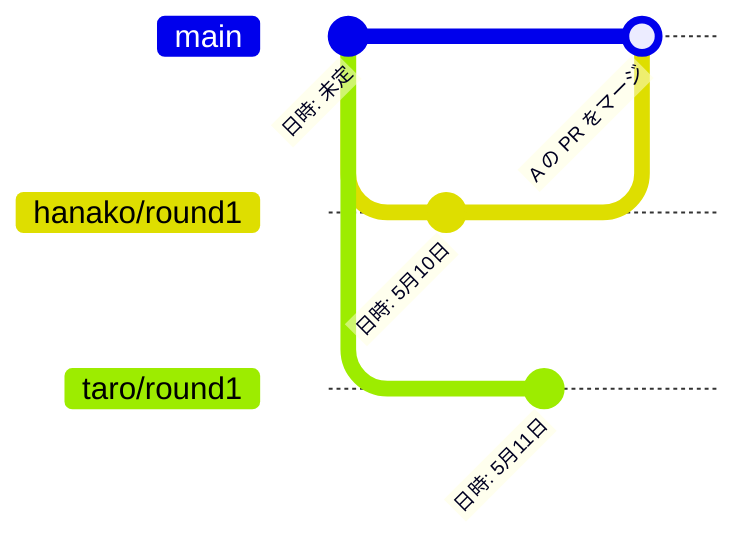

# 12日目：チームでのコンフリクト

[← 11日目](day11-code-review.md) ｜ [README（全体の地図）](../README.md) ｜ [13日目 →](day13-final-project.md)

## この日のゴール

- チーム開発でコンフリクトが起きるしくみを説明できる
- PR のコンフリクトを、手元（VS Code）で解決できる
- PR のコンフリクトを、GitHub 上の **Resolve conflicts** でも解決できる
- コンフリクトを減らす習慣を挙げられる

## 所要時間の目安

合計 **約90分**（**チーム全員で集まる日** です。オンライン通話＋画面共有でかまいません）

| セクション | 目安 |
|---|---|
| 1. チーム開発でコンフリクトが起きるしくみ | 10分 |
| 2. 準備：main を最新にする | 5分 |
| 3. ラウンド1：手元の VS Code で解決する | 35分 |
| 4. ラウンド2：GitHub 上で解決する | 30分 |
| 5. コンフリクトを減らす習慣 | 10分 |

> [!TIP]
> 今日の進行役は **D**（3人チームは **A**）です。進行役は「全員の PR がそろったか」「次は誰がマージするか」を声に出して確認してください。

## 前提

- 7日目でコンフリクトを解決したことがある（マーカーの読み方、VS Code での解決）
- 10〜11日目で PR を出し、レビューしてマージしたことがある
- 11日目の PR がすべてマージ済み（未マージの PR があっても練習はできますが、先に片付けておくと混乱しません）
- チームリポジトリが `~/git-practice/gitlearn-team-<チーム記号>` にクローンされている

今日の演習：[exercises/day12-team-conflict/README.md](../exercises/day12-team-conflict/README.md)
今日使うファイル：チームリポジトリの `exercises/team-project/schedule.md`

---

## 1. チーム開発でコンフリクトが起きるしくみ

7日目は、ひとりで2つのブランチを作ってコンフリクトを起こしました。チーム開発では、**別々の人が、同じ `main` から分かれたブランチで、同じ行を変える** とコンフリクトが起きます。



VS Code のプレビュー（`Ctrl+Shift+V`）では、上の図は表示されず、コードがそのまま見えます（GitHub 上では図として表示されます）。同じ内容を文字で書くと次のとおりです。

```text
main:  ●(日時: 未定) ─────────────────────● A の PR をマージ
         ├─ hanako/round1: ●(日時: 5月10日) ┘
         └─ taro/round1:   ●(日時: 5月11日)   ← main と同じ行がぶつかる
```

1. A（hanako）と B（taro）が、同じ `main` から自分のブランチを作ります。
2. 2人とも `schedule.md` の「日時:」の行を書き換えて、PR を出します。この時点では、どちらの PR もコンフリクトはありません。
3. A の PR が先にマージされると、`main` の「日時:」の行が変わります。
4. B の PR は「`main` の新しい内容」と「B の変更」が同じ行でぶつかるので、GitHub に **This branch has conflicts that must be resolved** と表示され、マージできなくなります（執筆時点の表示です）。

ポイントは、**コンフリクトは「後からマージする人」の PR で起きる** ということです。解決するのは、その PR の作者です。解決のしかたは2つあります。

| 方法 | どこで | 今日の練習 |
|---|---|---|
| `main` の最新を自分のブランチに **マージ** して、手元で解決して push する | 手元の VS Code | ラウンド1 |
| PR 画面の **Resolve conflicts** ボタンで、ブラウザ上で解決する | GitHub | ラウンド2 |

どちらも「`main` の内容を、自分のブランチに取り込んで（マージして）、ぶつかった行を直す」という点は同じです。

---

## 2. 準備：main を最新にする

全員で、次の手順を行います。

**Git Bash で**

`<...>` の部分は、かっこごと置き換えてから実行します。

1. チームリポジトリのフォルダに移動します。

   ```bash
   cd ~/git-practice/gitlearn-team-<チーム記号>
   ```

2. 作業中の変更がないことを確かめます。

   ```bash
   git status
   ```

   ```text
   On branch main
   Your branch is up to date with 'origin/main'.

   nothing to commit, working tree clean
   ```

   `main` 以外のブランチにいるときや、`Changes not staged for commit` などが出るときは、先にコミットするか、変更を片付けてください（[レシピ branch-03](../recipes/branch.md#branch-03)）。

3. `main` に切り替えます。

   ```bash
   git switch main
   ```

4. 最新にします。

   ```bash
   git pull
   ```

5. `schedule.md` の中身を確認します。

   ```bash
   cat exercises/team-project/schedule.md
   ```

   ```text
   # 次回の活動予定

   - 日時: 未定
   - 場所: 未定
   - 内容: 未定
   ```

**VS Code で**：ステータスバーのブランチ名から `main` を選ぶ → ソース管理ビューの「…」→「プル（Pull）」→ エクスプローラーで `exercises/team-project/schedule.md` を開きます。

---

## 3. ラウンド1：手元の VS Code で解決する

### 全員が同じ行を編集して PR を出す

全員が、次の手順を **同時に** 行います。

1. ラウンド1用のブランチを作ります。

   `<...>` の部分は、かっこごと置き換えてから実行します。

   ```bash
   git switch -c <GitHubユーザー名>/round1
   ```

2. VS Code で `exercises/team-project/schedule.md` を開き、`- 日時: 未定` の行 **だけ** を、自分の案に書き換えます。ほかの行は変えません。

   ```markdown
   - 日時: 5月10日（土）13:00
   ```

   日付や時刻は、人によって変えてください（同じ案になってもコンフリクトは起きますが、違うほうがわかりやすいです）。

3. 保存（`Ctrl+S`）してから、ステージしてコミットします。

   ```bash
   git add exercises/team-project/schedule.md
   ```

   ```bash
   git commit -m "活動予定の日時の案を書く"
   ```

4. push します。

   `<...>` の部分は、かっこごと置き換えてから実行します。

   ```bash
   git push -u origin <GitHubユーザー名>/round1
   ```

5. GitHub で PR を作ります。タイトルは「ラウンド1：日時の案（自分の名前）」のようにし、レビュアーにはいつもの組の相手を指定します。この練習には Issue がないので、`Closes #` の欄は「なし」でかまいません。

**VS Code で**：ステータスバーのブランチ名 →「+ 新しいブランチの作成」→ 編集・保存 → ソース管理ビューで「+」→「✓ コミット」→「ブランチの発行（Publish Branch）」。

> [!WARNING]
> **全員の PR がそろうまで、誰もマージしないでください。** 早くマージすると、後の人のブランチが最新の `main` から作られてしまい、コンフリクトが起きなくなります。

### 決めた順番でマージする

マージの順番は **A → B → C → D**（3人チームは A → B → C）です。

1. 進行役が、全員の PR がそろったことを確認します（**Pull requests** タブに人数分の PR が並んでいる）。
2. A の PR を、組の相手（B）がレビューして **Approve** します。
3. A が **Merge pull request** → **Confirm merge** でマージし、**Delete branch** を押します。
4. 全員で、B の PR 画面を開いてみます。下のほうに **This branch has conflicts that must be resolved** と表示され、マージボタンが押せなくなっているはずです。C・D の PR も同じ状態になっています。

### コンフリクトした PR を手元で解決する

ここからは、**B が** 画面共有しながら行います。B が終わってマージしたら、C、D の順に同じ手順を行います（前の人のマージによって、次の人の PR がコンフリクトします）。

**Git Bash で**

`<...>` の部分は、かっこごと置き換えてから実行します。

1. 自分のラウンド1のブランチに切り替えます。

   ```bash
   git switch <GitHubユーザー名>/round1
   ```

2. GitHub の最新の情報を取ってきます（`origin/main` が、A のマージ後の状態に更新されます）。

   ```bash
   git fetch origin
   ```

3. 最新の `main`（`origin/main`）を、自分のブランチにマージします。

   ```bash
   git merge origin/main
   ```

   ```text
   Auto-merging exercises/team-project/schedule.md
   CONFLICT (content): Merge conflict in exercises/team-project/schedule.md
   Automatic merge failed; fix conflicts and then commit the result.
   ```

   7日目と同じコンフリクトの表示です。あわてなくて大丈夫です。

4. VS Code で `exercises/team-project/schedule.md` を開きます。次のように表示されます。

   ```text
   # 次回の活動予定

   <<<<<<< HEAD
   - 日時: 5月11日（日）10:00
   =======
   - 日時: 5月10日（土）13:00
   >>>>>>> origin/main
   - 場所: 未定
   - 内容: 未定
   ```

   | 部分 | 中身 | VS Code での呼び方 |
   |---|---|---|
   | `<<<<<<< HEAD` 〜 `=======` | **自分のブランチ** の内容（自分の案） | 現在の変更（Current Change） |
   | `=======` 〜 `>>>>>>> origin/main` | **main の最新** の内容（先にマージされた人の案） | 入力側の変更（Incoming Change） |

   > [!NOTE]
   > 7日目は `main` にいて `change-place` を取り込んだので、「現在」＝`main` でした。今日は **自分のブランチにいて `main` を取り込む** ので、「現在」＝自分の案、「入力側」＝`main`（ほかの人の案）です。逆になっていることに注意してください。

5. 今日は **両方の案を残します**。コンフリクトの上に表示される「**両方の変更を取り込む（Accept Both Changes）**」を押します。すると、マーカーが消えて2行が残ります。

   ```markdown
   - 日時: 5月11日（日）10:00
   - 日時: 5月10日（土）13:00
   ```

6. 2行を手で1行にまとめます。**先にマージされた人の案（main の内容）を前に** 書き、` / ` で区切って自分の案を後ろに足します。

   ```markdown
   - 日時: 5月10日（土）13:00 / 5月11日（日）10:00
   ```

   C、D が解決するときは、`main` にはすでに2つ（3つ）の案が入っているので、その後ろに自分の案を足します。例：`- 日時: 5月10日（土）13:00 / 5月11日（日）10:00 / 5月17日（土）15:00`

7. `<<<<<<<`、`=======`、`>>>>>>>` の行が残っていないことを確かめて、保存（`Ctrl+S`）します。
8. 解決したファイルをステージします。

   ```bash
   git add exercises/team-project/schedule.md
   ```

9. マージを完了するコミットを作ります。

   ```bash
   git commit -m "日時のコンフリクトを解決（両方の案を残す）"
   ```

   > [!TIP]
   > `-m` を付けずに `git commit` と入力すると、VS Code に「Merge remote-tracking branch 'origin/main' into ...」というメッセージが入った画面が開きます（7日目と同じ）。そのままタブを閉じれば、そのメッセージでコミットされます。

10. 履歴を確かめます。自分のブランチに `main` の内容が合流したことがわかります。

    ```bash
    git log --oneline --graph --all
    ```

    ```text
    *   c57458c (HEAD -> taro/round1) 日時のコンフリクトを解決（両方の案を残す）
    |\
    | *   1e59ad3 (origin/main, origin/HEAD) Merge pull request #15 from hanako/round1
    | |\
    | | * dfdd82f 活動予定の日時の案を書く
    | |/
    * / 709d877 (origin/taro/round1) 活動予定の日時の案を書く
    |/
    ...
    ```

    （ハッシュ値や番号、名前は人によって違います。`main` の位置が古いまま表示されますが、`main` は後で `git pull` するので問題ありません）

11. push します。

    ```bash
    git push
    ```

12. GitHub の PR 画面を再読み込みします。コンフリクトの表示が消え、**This branch has no conflicts with the base branch** と表示されれば成功です。
13. 組の相手が **Files changed** で解決内容を確認して **Approve** し、作者がマージします（**Delete branch** も押します）。
14. 次の人（C、その次に D）が、手順1から同じように解決します。

**VS Code で（GUI で行う場合）**

1. ステータスバーのブランチ名をクリックし、自分の `<GitHubユーザー名>/round1` を選びます。
2. ソース管理ビューの「…」→「フェッチ（Fetch）」を押します。
3. コマンドパレット（`Ctrl+Shift+P`）で「Git: ブランチをマージ…（Git: Merge Branch...）」を選び、一覧から `origin/main` を選びます。
4. ソース管理ビューの「変更のマージ（Merge Changes）」の下に `schedule.md` が表示されます。クリックして開き、上の手順5〜7と同じように解決して保存します。
   - 右下の「**マージ エディターで解決（Resolve in Merge Editor）**」を押すと、左に「入力側（Incoming）」、右に「現在（Current）」、下に「結果（Result）」が並ぶマージエディターで解決することもできます。結果を整えたら「**マージの完了（Complete Merge）**」を押します（ファイルがステージされます）。
5. ファイルの「+」（変更をステージ）を押します（マージエディターで「マージの完了」を押した場合は不要です）。
6. メッセージ欄に「日時のコンフリクトを解決（両方の案を残す）」と入力し、「✓ コミット」を押します。
7. 「変更の同期（Sync Changes）」を押して push します。

VS Code のボタン名は執筆時点のものです。出典：[VS Code Docs「Resolve conflicts」](https://code.visualstudio.com/docs/sourcecontrol/merge-conflicts)

> [!TIP]
> 途中でわからなくなったら、`git merge --abort` でマージ前の状態に戻せます（7日目）。落ち着いてから、手順3の `git merge origin/main` からやり直してください。詳しくは [レシピ branch-06](../recipes/branch.md#branch-06)、[レシピ branch-08](../recipes/branch.md#branch-08)。

> [!NOTE]
> `main` の最新を取り込む方法には、merge の代わりに **rebase** を使うやり方もあります。13日目の発展で紹介します（[Appendix：rebase](../appendix/rebase.md)）。

### ラウンド1の後片付け

全員の PR がマージされたら、全員で次の手順を行います。

`<...>` の部分は、かっこごと置き換えてから実行します。

```bash
git switch main
```

```bash
git pull
```

```bash
git branch -d <GitHubユーザー名>/round1
```

```bash
cat exercises/team-project/schedule.md
```

```text
# 次回の活動予定

- 日時: 5月10日（土）13:00 / 5月11日（日）10:00 / 5月17日（土）15:00 / 5月18日（日）11:00
- 場所: 未定
- 内容: 未定
```

（4人チームなら、全員の案が1行に並んでいます）

---

## 4. ラウンド2：GitHub 上で解決する

ラウンド2では、`- 場所: 未定` の行を使います。今度は、手元ではなく **GitHub のブラウザ上** で解決します。

### 逆の順番でマージする

1. 全員が、`main` が最新であることを確かめます（ラウンド1の後片付けで `git pull` 済みなら OK です）。
2. 全員が、ラウンド2用のブランチを作ります。

   `<...>` の部分は、かっこごと置き換えてから実行します。

   ```bash
   git switch -c <GitHubユーザー名>/round2
   ```

3. `schedule.md` の `- 場所: 未定` の行 **だけ** を、自分の案に書き換えて保存します。例：

   ```markdown
   - 場所: 学生会館 2階 会議室
   ```

4. ステージ・コミット・push します。

   ```bash
   git add exercises/team-project/schedule.md
   ```

   ```bash
   git commit -m "活動予定の場所の案を書く"
   ```

   `<...>` の部分は、かっこごと置き換えてから実行します。

   ```bash
   git push -u origin <GitHubユーザー名>/round2
   ```

5. PR を作ります（タイトル例：「ラウンド2：場所の案（自分の名前）」）。
6. **全員の PR がそろうまで待ちます。**
7. 今度は **逆の順番** でマージします。
   - 4人チーム：**D → C → B → A**
   - 3人チーム：**C → B → A**
8. 最初の人（4人なら D）の PR を組の相手が承認（Approve）し、D がマージします。残りの人の PR にコンフリクトが表示されます。

### Resolve conflicts ボタンで解決する

2番目の人（4人なら C）から順に、画面共有しながら行います。

1. GitHub で自分の PR を開きます。
2. 下のほうの「This branch has conflicts that must be resolved」の欄にある **Resolve conflicts** ボタンを押します。
3. ブラウザ上のエディターに、コンフリクトしたファイル（`schedule.md`）が表示されます。手元と同じマーカーが入っています。

   ```text
   <<<<<<< yuki/round2
   - 場所: 学生会館 2階 会議室
   =======
   - 場所: 体育館 第2アリーナ
   >>>>>>> main
   ```

   今回は、`<<<<<<<` の後に **自分のブランチ名**、`>>>>>>>` の後に **main** と書かれています（上は2番目に解決する C（例：yuki）の画面の例です）。

4. ラウンド1と同じく、**両方の案を残して1行にまとめます**。エディターの中で文字を直接書き換えて、マーカーの3行（`<<<<<<<`、`=======`、`>>>>>>>`）を削除し、次のようにします（先にマージされた main の案を前にします）。

   ```markdown
   - 場所: 体育館 第2アリーナ / 学生会館 2階 会議室
   ```

5. マーカーがすべて消えると、右上の **Mark as resolved** が押せるようになります。押します。
6. ほかにコンフリクトしたファイルがあれば、左側の一覧から選んで同じように解決します（今日は `schedule.md` だけです）。
7. **Commit merge** を押します。
8. PR 画面に戻ると、「main を自分のブランチにマージしたコミット」が追加され、コンフリクトの表示が消えています。
9. 組の相手が **Files changed** で確認して **Approve** し、作者が **Merge pull request** → **Confirm merge** → **Delete branch** を押します。
10. 次の人が、手順1から同じように解決します。

> [!NOTE]
> - **Resolve conflicts** を使うと、GitHub 上で「`main` を自分のブランチにマージするコミット」が作られます。ラウンド1で手元で行った `git merge origin/main` と同じことを、GitHub がやってくれていると考えてください。
> - **Resolve conflicts** ボタンが灰色で押せない場合は、GitHub のエディターでは扱えない種類のコンフリクト（ファイルの削除と変更がぶつかった場合など）です。ラウンド1の手順（手元で解決）を使ってください。
> - head ブランチ（自分の `round2`）が保護されている場合などに、ブランチの確認画面が出ることがあります。今日の練習では出ないのが普通ですが、出たら **I understand, continue updating <ブランチ名>** を選びます。

出典：[GitHub Docs「Resolving a merge conflict on GitHub」](https://docs.github.com/en/pull-requests/collaborating-with-pull-requests/addressing-merge-conflicts/resolving-a-merge-conflict-on-github)、[レシピ github-09](../recipes/github.md#github-09)

### 手元に反映する

全員の PR がマージされたら、全員で手元を最新にします。

`<...>` の部分は、かっこごと置き換えてから実行します。

```bash
git switch main
```

```bash
git pull
```

```bash
git branch -d <GitHubユーザー名>/round2
```

```bash
cat exercises/team-project/schedule.md
```

```text
# 次回の活動予定

- 日時: 5月10日（土）13:00 / 5月11日（日）10:00 / 5月17日（土）15:00 / 5月18日（日）11:00
- 場所: 体育館 第2アリーナ / 学生会館 2階 会議室 / 部室 / オンライン
- 内容: 未定
```

> [!NOTE]
> GitHub 上で解決したので、手元の `round2` ブランチには解決のコミットがありません。でも、自分の案のコミットはすでに `main` に入っているので、`git branch -d` で問題なく削除できます。

`git log --oneline --graph --all` で、ラウンド1・2のマージの様子を眺めてみましょう。複数の線が合流しているのがわかります。

> [!TIP]
> `schedule.md` には複数の案が残ったままです。13日目に、チームで1つに決めて確定版に整えます。

---

## 5. コンフリクトを減らす習慣

コンフリクトは「悪いこと」ではなく、チーム開発では自然に起きるものです。ただ、次の習慣で減らしたり、小さくしたりできます。

| 習慣 | 理由 |
|---|---|
| **作業を始める前に `git switch main` → `git pull`** | 古い `main` から作業を始めると、ぶつかる可能性が高くなります |
| **こまめに `main` を取り込む**（`git fetch origin` → `git merge origin/main`） | 作業が長引くときは、途中で取り込めば、コンフリクトが小さいうちに解決できます |
| **PR を小さくする** | 変更が少ないほど、ぶつかる場所も少なく、レビューも早く終わります |
| **担当ファイルを分ける** | 10・11日目にコンフリクトが起きなかったのは、各自が別のファイルを編集したからです |
| **同じファイルを触るときは事前に声をかける** | 「`README.md` の目次を直します」と Issue やチャットで一言伝えるだけで、ぶつかりにくくなります |
| **早めにマージする** | Approve された PR を放置しないことで、ほかの人がぶつかる時間を減らせます |

チームで話し合ってみましょう：「13日目の最終課題で、コンフリクトが起きそうなのはどこか？」（ヒント：全員が同じファイルに書き込む作業があります）

---

## 確認チェックリスト

- [ ] 「後からマージする PR でコンフリクトが起きる」しくみを、自分の言葉で説明できる
- [ ] ラウンド1またはラウンド2で、自分の PR のコンフリクトを1回以上解決した
- [ ] ラウンド1で `git fetch origin` → `git merge origin/main` → 解決 → `git add` → `git commit` → `git push` の流れを実行した（または見ていた）
- [ ] ラウンド2で **Resolve conflicts** → **Mark as resolved** → **Commit merge** の流れを実行した（または見ていた）
- [ ] 手元の `main` で `cat exercises/team-project/schedule.md` を実行し、全員の案が「日時」「場所」の行に残っている
- [ ] `git branch` で、`round1` と `round2` のブランチが手元に残っていない
- [ ] コンフリクトを減らす習慣を2つ以上挙げられる

## よくあるつまずき

**症状：`git merge origin/main` をしてもコンフリクトが起きない（`Already up to date.` と出る）**
- 原因：`git fetch origin` を忘れていて、手元の `origin/main` が古いままです。または、まだ前の人の PR がマージされていません。
- 対処：前の人のマージが終わったことを確認してから、`git fetch origin` → `git merge origin/main` をやり直します。

**症状：`git switch` すると `Your local changes to the following files would be overwritten` と出て切り替えられない**
- 原因：コミットしていない変更が残っています。
- 対処：→ [レシピ trouble-05](../recipes/troubleshooting.md#trouble-05)

**症状：`git push` が `! [rejected]` で拒否された**
- 原因：GitHub 上の自分のブランチが、手元より進んでいます（ラウンド2で GitHub 上で解決した後、手元の古い `round2` ブランチから push しようとした、など）。
- 対処：ラウンド2のブランチは手元で作業を続ける必要はありません。`git switch main` → `git pull` して、`round2` は削除します。続けて作業したいときは `git pull` してから push します（[レシピ trouble-04](../recipes/troubleshooting.md#trouble-04)）。

**症状：解決したのに、PR にまだ「conflicts」と表示される**
- 原因：解決のコミットを push していない、またはマーカーが残ったままコミットした可能性があります。
- 対処：`git status` で `Your branch is ahead of ...` と出ていれば `git push` します。マーカーが残っていたら、ファイルを直して `git add` → `git commit` → `git push` します。

**症状：解決した後に別の人がマージして、またコンフリクトになった**
- 原因：自分が解決している間に、`main` がさらに進みました。
- 対処：正常な動きです。もう一度 `git fetch origin` → `git merge origin/main` で解決します。マージの順番を守り、前の人のマージが終わってから解決を始めると防げます。

**症状：`git branch -d` で `error: the branch '...' is not fully merged` と出る**
- 原因：そのブランチの PR がまだマージされていない、または手元の `main` が最新になっていません。
- 対処：PR がマージ済みか GitHub で確かめ、`git switch main` → `git pull` してからもう一度削除します。→ [レシピ branch-04](../recipes/branch.md#branch-04)

## もっと知りたい人へ

- [Appendix：ブランチとマージのしくみ](../appendix/branches-and-merge.md)：コンフリクトが起きる条件・起きない条件、マージエディター
- [Appendix：リモート追跡ブランチ](../appendix/remote-tracking.md)：`origin/main` と `fetch`、push が拒否される理由
- [Appendix：rebase](../appendix/rebase.md)：merge の代わりに rebase で `main` を取り込む方法
- レシピ
  - [branch-06 コンフリクトを解決したい／マージをやめたい](../recipes/branch.md#branch-06)
  - [branch-08 作業中のブランチに main の最新を取り込みたい](../recipes/branch.md#branch-08)
  - [github-09 PR のコンフリクトを GitHub 上で解決したい](../recipes/github.md#github-09)
  - [trouble-05 `Your local changes to the following files would be overwritten` と出る](../recipes/troubleshooting.md#trouble-05)

---
[← 11日目](day11-code-review.md) ｜ [README](../README.md) ｜ [13日目 →](day13-final-project.md)
